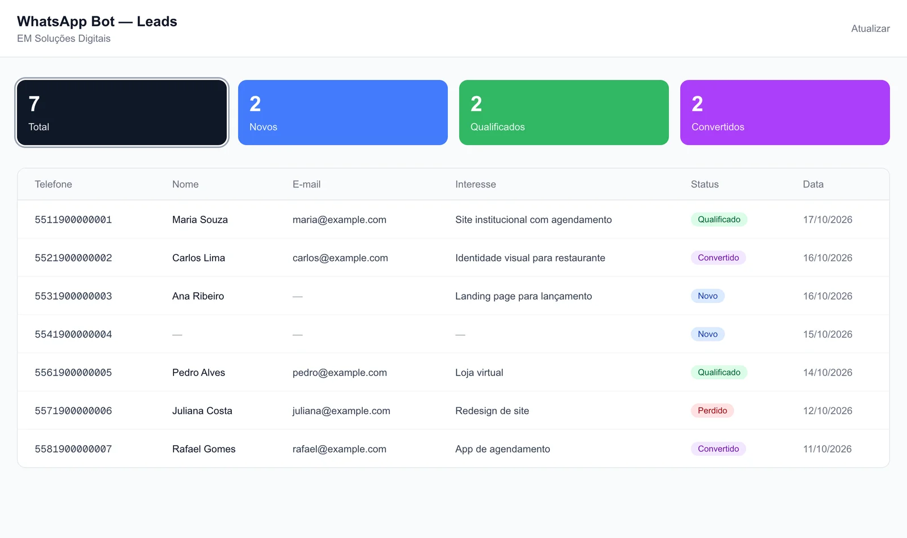
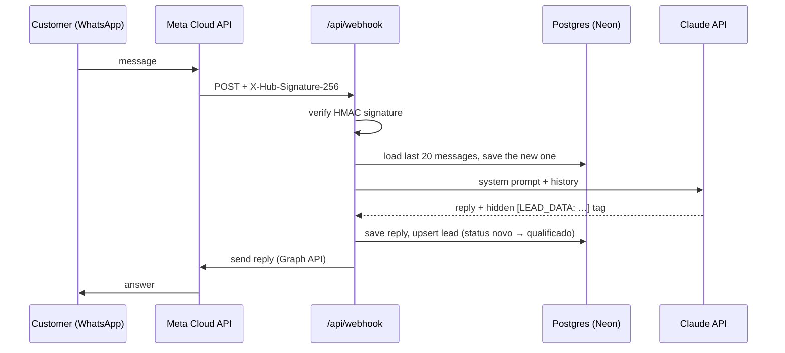

# WhatsApp AI Assistant

A WhatsApp Business assistant powered by the Claude API. It answers prospective clients in Brazilian Portuguese,
qualifies them during a natural conversation (name, e-mail, what they need) and drops each lead into a small
dashboard. I built it for my studio, [EM Soluções Digitais](https://emsolucoesdigitais.com.br/en).

**Live:** not publicly deployed. The dashboard holds real customer contacts, so the demo below uses fictitious data;
run it locally to try it.



## How it works



## Stack

Next.js 16 (App Router, Route Handlers, Proxy) · React 19 · TypeScript · Tailwind CSS 4 · Anthropic TypeScript SDK ·
WhatsApp Cloud API (Graph API v21) · Neon serverless Postgres · Vercel

## Highlights

- **Lead extraction without a second model call.** The system prompt asks Claude to append a hidden
  `[LEAD_DATA: name="…" email="…" interest="…"]` tag only for fields it is sure about. The server parses and strips
  it before replying ([`lib/claude.ts`](lib/claude.ts)), so qualification costs no extra request.
- **Conversation memory in Postgres.** Each phone number keeps its own history (last 20 turns sent as context), and
  leads are upserted with `COALESCE`, so a later message never erases a field captured earlier
  ([`lib/db.ts`](lib/db.ts), [`db/schema.sql`](db/schema.sql)).
- **Webhook hardening.** `GET` answers Meta's verification challenge; `POST` verifies the `X-Hub-Signature-256`
  HMAC with a constant-time comparison before parsing anything, and always returns 200 after that so Meta does not
  retry-storm on internal errors ([`app/api/webhook/route.ts`](app/api/webhook/route.ts)).
- **Customer data stays behind auth.** The dashboard and `/api/leads` sit behind HTTP Basic auth in a Next.js 16
  Proxy ([`proxy.ts`](proxy.ts)), and are disabled entirely when no credentials are configured.
- **Server-rendered dashboard.** The leads table is a Server Component that queries the database directly; only the
  status filter is a Client Component. An LGPD privacy page (`/privacidade`) is included, as Meta requires one.

## Run it locally

```bash
npm install
cp .env.example .env.local   # fill in the keys
psql "$DATABASE_URL" -f db/schema.sql
npm run dev                  # http://localhost:3000, dashboard at /dashboard
```

To receive real messages, expose the dev server (for example with `ngrok http 3000`) and register
`https://<your-tunnel>/api/webhook` as the callback URL in your Meta app, with the same verify token as
`WHATSAPP_WEBHOOK_VERIFY_TOKEN`, subscribed to the `messages` field.

## License

[MIT](LICENSE)
